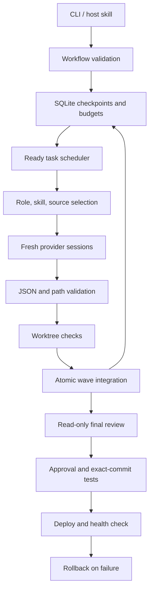

# Runtime architecture

## Runtime vs host responsibilities

The host CLI handles authentication, model communication, and its own inference machinery. The runtime
handles selection of ready tasks, role/skill loading, bounded inputs, process lifetime, isolated Git
workspaces, validation, artifact writes, checks, durable state and release commands. A skill folder is
not a running agent. `providers.invoke` is the point where an actual independent process/session starts.

The generic command adapter allows a different agent host to participate without changing the scheduler.
It must obey stdin→JSON, no direct workspace edits, nonzero error status. A REST agent can be wrapped by
such a command. This release does not claim native REST, MCP or every vendor's CLI support.

## Task lifecycle

Pending tasks whose dependencies succeeded enter a bounded execution wave. Each worker receives the
same wave-head commit, a new detached worktree, only direct predecessor summaries, its role/skill and
selected source. Failed attempts are retried from a fresh copy of that same head with failure feedback.
The runtime checks the complete proposed path set before writing anything, stages only proposed files,
executes configured checks, detects check mutations of tracked source and makes an isolated commit.

Successful worker commits are cherry-picked in task-ID order into the integration worktree. Same-path
writes in one wave fail even if Git might merge them. Wave checks run again on the combined result.
Only after all integrations/checks succeed does one SQLite transaction update the run head and mark
these tasks succeeded. A conflict resets the integration worktree to the previous checkpoint and marks
that wave failed. Other successful waves are retained.

## Crash consistency

State lives under the repository's Git directory, `sdlc-agent/state.sqlite3`. User source files and the
original checkout remain untouched. OS advisory locks prevent two schedulers from executing one run.
After a crash the lock releases automatically. On resume, stale running tasks become pending and an
integration worktree is reconstructed from the SQLite head. A Git commit made just before a crash but
not checkpointed may be abandoned and recomputed. The final `sdlc/RUN_ID` ref is reconstructed from the
checkpoint as work proceeds. SQLite WAL and a 30-second busy timeout coordinate parallel workers.

Deployment intent is saved before running side effects. A crash after intent leaves `deploying` and
blocks automatic resume. This is deliberately at-most-automatic-once behavior around an uncertain
external side effect, not a claim of distributed exactly-once transactions. Operators reconcile the
target. Rollback success is recorded as a failure of the release, never as release success.

## Repair and freshness

Repair uses the last integrated head as the new run base, retains unrelated succeeded tasks, and
invalidates the selected task and every descendant. Original diagnostics and history remain available.
Final review depends on all preceding tasks; release depends on that review and all other tasks.
Consequently a repair cannot reuse stale downstream review or test completion. Test commands execute
again on the precise release head. Workflow changes require a new run rather than mutating an active
run's trusted command definitions.

## Trust boundaries and deployment scope

The JSON contract constrains what the runtime writes. It does not convert an arbitrary command provider,
repository test suite, Python interpreter or deployment script into untrusted code that is safe to run.
Use external container/VM sandboxing and scoped credentials for untrusted input. Worktrees isolate Git
changes and avoid shared-file races but share an OS, environment and Git object database.

Checks run as trusted executable argv arrays, never implicitly through a shell. Explicitly configuring
`bash -c` is still shell execution authorized by the workflow and should be reviewed accordingly.
Deployment scripts are the environment adapter: Kubernetes, SSH, cloud release APIs and local services
can all be invoked, but their configuration and idempotency remain application-specific.

## MCP decision

The default path uses local scripts because deterministic operations do not require model reasoning or
new tool schemas at every step. MCP is useful when the same remote service must be shared by multiple
hosts with a standard discovery and authorization boundary. Both approaches can be efficient when
schemas are loaded lazily and output is bounded. No numerical token/latency improvement is asserted
without a paired workload measurement.

Official references checked during implementation:

- https://code.claude.com/docs/en/cli-reference
- https://code.claude.com/docs/en/plugins-reference
- https://developers.openai.com/codex/noninteractive
- https://modelcontextprotocol.io/

Installed Codex `exec --help` was also checked for the concrete adapter flags. CLI versions can change;
adapter contract tests guard command construction, while live smoke tests should be run against the
organization's pinned host versions before rolling out an upgrade.
