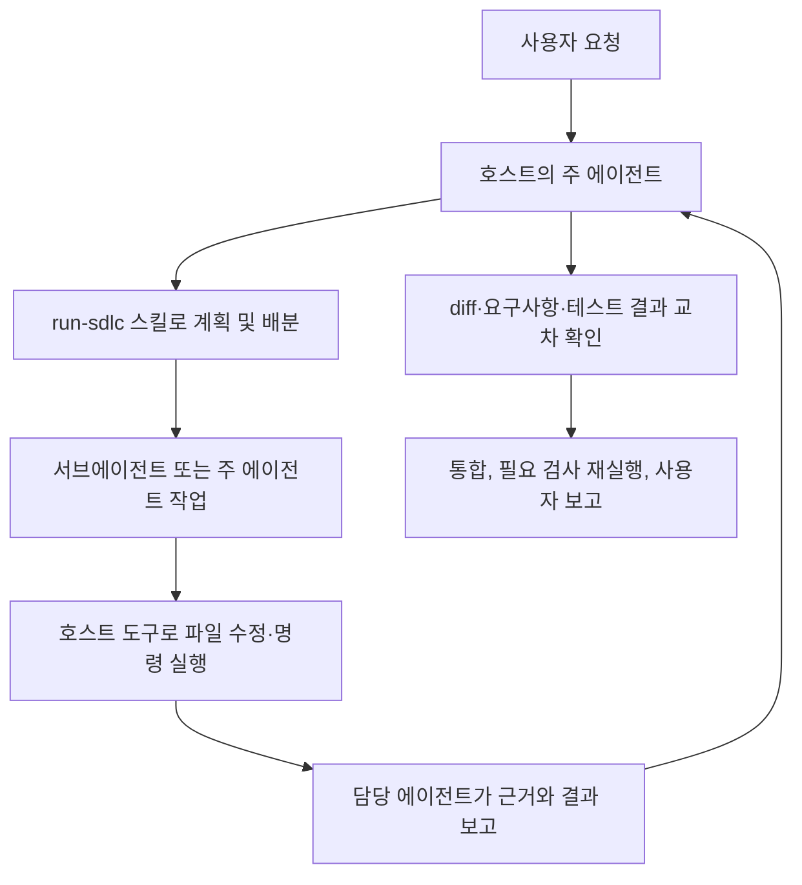

# SDLC Agent Plugin 개발가이드

이 문서는 저장소를 처음 받는 개발자가 플러그인을 이해하고, 역할·스킬·훅을 수정하고, 검증 후 기여하는 방법을 설명합니다. 설명 대상은 런타임이 삭제된 호스트 플러그인 구조입니다.

## 1. 한눈에 보는 실행 흐름



호스트(Codex 또는 Claude Code)가 모델과 대화 루프, 파일·터미널 도구, 서브에이전트 실행을 제공합니다. 이 저장소에는 작업을 실제로 실행하는 별도 오케스트레이터 프로그램이 없습니다. 플러그인의 `run-sdlc` 스킬이 호스트에게 계획·배분·확인 절차를 안내합니다.

## 2. 작업 배분과 결과 검증

### 배분 절차

1. 주 에이전트가 저장소 지침, Git 상태, 요청 범위를 확인합니다.
2. `artifacts/sdlc-progress.md`에 요구사항 ID, 작업 의존성, 담당 파일 범위, 진행 상태를 기록합니다.
3. 각 작업에 입력 자료, 구체 목표, 수정 허용 경로, 완료 조건, 실행할 검증을 붙입니다.
4. 서로 의존하지 않고 편집 파일도 겹치지 않는 작업만 병렬 배분합니다. 예를 들어 한 에이전트가 API 계약을 검토하는 동안 다른 에이전트는 별도 문서 파일을 작성할 수 있습니다.
5. 같은 파일을 여러 에이전트가 수정해야 하거나 결과 의존성이 있으면 순차 실행하거나 별도 worktree를 사용합니다.
6. 서브에이전트 기능이 호스트에서 제공되지 않으면 주 에이전트가 같은 순서로 작업합니다.

### 결과 검증 절차

서브에이전트의 완료 문구만으로 완료 처리하지 않습니다. 담당자에게 다음 형식으로 요약을 돌려받도록 합니다.

| 결과 항목 | 확인 내용 |
|---|---|
| 요구사항 | 처리한 요구사항 ID와 충족 여부 |
| 파일 | 실제 수정한 경로와 변경 요약 |
| 검사 | 실행한 명령, 종료 코드, 핵심 결과 |
| 미해결 | 실패·차단·추가 결정이 필요한 항목 |
| 다음 단계 | 통합 또는 후속 작업 |

주 에이전트는 보고된 파일을 직접 읽고 Git diff와 대조합니다. 테스트는 가능하면 직접 실행하거나 실행 로그·종료 코드를 확인합니다. 요구사항 수용 조건과 변경을 연결하고, 중복·충돌 변경을 통합합니다. 코드가 바뀐 뒤에는 이전 테스트나 리뷰를 최신 증거로 간주하지 않고 영향을 받는 검사를 다시 수행합니다. 리뷰 에이전트는 구현 파일을 고치지 않고 발견 사항을 반환하며, 주 에이전트가 수정 및 재검증을 담당합니다.

### 현재 자동화의 경계

- 배분과 완료 판단은 호스트 모델이 스킬 지침을 따라 수행합니다. 전용 큐·DB·상태 전이 엔진은 없습니다.
- 체크포인트는 Markdown 파일이므로 Git 변경과 비교해 정확성을 확인해야 합니다. 자동 잠금, 트랜잭션, 강제 게이트는 제공하지 않습니다.
- 서브에이전트의 독립 컨텍스트와 병렬 실행 방식은 호스트가 결정합니다. 이 플러그인은 Codex와 Claude의 내부 스케줄러를 대체하거나 제어하지 않습니다.
- 역할 지침은 수정 범위를 제한하지만 권한 경계 그 자체는 아닙니다. 파일 권한과 승인 정책은 호스트 설정을 따릅니다.
- 테스트 성공은 실제 명령 실행 결과로 확인합니다. 스킬·훅이 검증 통과를 기술적으로 보장한다고 주장하지 않습니다.

## 3. 폴더와 파일의 관계

| 경로 | 쓰임 | 수정 기준 |
|---|---|---|
| `.codex-plugin/plugin.json` | Codex 호환 메타데이터 | 설명, 버전, 제작자 등 바뀔 때 |
| `.codex-plugin/plugin.json` | Codex 패키지 매니페스트 | Codex 패키지 기능을 바꿀 때 |
| `.claude-plugin/plugin.json` | Claude Code 매니페스트 | Claude 패키지 설정을 바꿀 때 |
| `skills/<name>/SKILL.md` | 각 스킬의 단일 원본 | 작업 방법·완료 조건 수정 시 |
| `agents/*.md` | Claude 역할 이름·설명·도구·지침 | Claude 전용 에이전트 조정 시 |
| `.codex/agents/*.toml` | Codex 프로젝트 에이전트 예시 | Codex 역할 지침 조정 시 |
| `hooks/hooks.json` | 호스트 이벤트와 명령 연결 | 이벤트 등록·변경 시 |
| `hooks/session-start.sh` | 세션 시작 시 짧은 안내 출력 | 훅 동작 자체를 변경할 때 |
| `.github/workflows/sdlc-agent.yml` | PR과 push에서 검증 명령 실행 | 검증 환경이나 명령 변경 시 |
| `docs/` | 설계·연결·검증·개발 설명 | 구현 동작과 설명이 달라질 때 |

## 4. 핵심 파일 구문별 설명

### 4.1 스킬 파일 머리말

예시: `skills/run-sdlc/SKILL.md`

```yaml
---
name: run-sdlc
description: Use for end-to-end feature delivery, SDLC planning, implementation, testing, review, or resuming a feature in Codex or Claude.
---
```

| 줄 또는 구문 | 의미 |
|---|---|
| 첫 번째 `---` | YAML 메타데이터 영역의 시작 |
| `name` | 호스트가 스킬을 식별할 이름. 디렉터리 이름과 맞춰 두면 찾기 쉽습니다. |
| `description` | 스킬을 언제 사용할지 호스트에 알려주는 짧은 설명 |
| 두 번째 `---` | 메타데이터 영역의 끝. 아래부터 본문 지침입니다. |

본문의 번호 목록은 실행 순서입니다. 각 지침은 주 에이전트가 무엇을 먼저 읽고, 언제 하위 스킬을 불러오고, 어떤 증거를 확인할지 정합니다. 다른 여섯 스킬도 같은 머리말 구조이며 본문 주제만 요구사항·설계·구현·검증·리뷰·배포로 나뉩니다.

### 4.2 플러그인 매니페스트

대표 파일: `.codex-plugin/plugin.json`, `.claude-plugin/plugin.json`

| JSON 키 | 목적 |
|---|---|
| `name` | 플러그인 식별자. Marketplace 및 설치 화면의 이름과 연결됩니다. |
| `version` | 배포 버전. 기능 변경 시 올려 호스트가 업데이트를 구분하도록 합니다. |
| `description` | 플러그인의 역할을 짧게 설명합니다. |
| `author.name` | 제작자 표시 이름 |
| `repository` | 원본 저장소 주소 |
| `license` | 코드 사용 조건 |
| `skills` | 스킬 폴더의 상대 경로. Codex 매니페스트에서 명시합니다. |


### 4.3 Claude 에이전트 정의

예시: `agents/review.md`

```yaml
---
name: sdlc-review
description: SDLC review specialist.
tools: Read, Grep, Glob
---
```

- `name`은 호스트에서 호출할 역할 이름입니다.
- `description`은 어떤 작업을 맡길지 알려줍니다.
- `tools`는 이 역할이 사용할 수 있는 도구 목록입니다. 리뷰어에는 읽기·검색만 허용해 구현 수정과 역할을 구분합니다.
- 두 `---` 사이가 메타데이터이며, 뒤의 Markdown은 담당 절차와 반환 형식입니다.
- 마지막 핸드오프 지침은 요구사항, 경로, 검사 증거, 발견 사항, 차단 요소, 다음 행동을 상위 담당자에게 전달하게 합니다.

### 4.4 Codex 에이전트 TOML

예시: `.codex/agents/sdlc-review.toml`

```toml
name = "sdlc-review"
description = "SDLC review specialist"
developer_instructions = "..."
```

각 줄은 TOML 문자열 설정입니다. Codex가 식별할 `name`, 배정 기준이 되는 `description`, 실제 역할 행동을 적은 `developer_instructions`를 제공합니다. 이 예시 파일은 플러그인 폴더에서 자동 발견된다고 전제하지 않습니다. Codex 프로젝트의 `.codex/agents/`에 복사하면 프로젝트 역할로 사용할 수 있습니다. Claude Markdown 정의와 내용을 함께 바꾸어야 역할 동작이 일치합니다.

### 4.5 훅 연결 JSON

예시: `hooks/hooks.json`

```json
{
  "hooks": {
    "SessionStart": [
      {
        "hooks": [
          {
            "type": "command",
            "command": "sh \"${CLAUDE_PLUGIN_ROOT}/hooks/session-start.sh\""
          }
        ]
      }
    ]
  }
}
```

- 바깥 `hooks` 객체는 이벤트별 설정 묶음입니다.
- `SessionStart`는 새 세션이 시작될 때 반응할 이벤트입니다.
- 배열은 같은 이벤트에 여러 매처·실행 정의를 넣을 수 있게 합니다.
- 내부 `hooks` 배열은 실행할 훅 핸들러를 담습니다.
- `type: command`는 셸 명령을 실행한다는 뜻입니다.
- `command`는 플러그인 설치 경로 변수를 사용해 스크립트를 찾습니다.

Codex 호환 플러그인도 Claude 환경 변수 이름을 호환 목적으로 설정한다는 현재 패키징 동작을 사용합니다. 호스트별 플러그인 설치 환경에서 이 경로 변수가 실제 설정되는지 설치 검증이 필요합니다. 이벤트 형식이나 경로 규칙을 바꾸면 Codex와 Claude에서 각각 확인합니다.

### 4.6 훅 셸 스크립트

`hooks/session-start.sh`는 `#!/bin/sh`로 POSIX 셸을 지정합니다. 주석은 네트워크, 모델 호출, 저장소 상태 변경을 하지 않는 정적 알림임을 기록합니다. `printf '%s\\n'`은 고정된 한 줄 안내를 표준 출력에 씁니다. 외부 명령이나 파일 쓰기를 넣으면 실행 권한·실패 처리·보안 검토도 함께 추가해야 합니다.

### 4.7 단일 스킬 원본

skills/가 개발 원본이자 설치 파일이다. 복사 스크립트는 제거했다. 이 경로에서 바로 수정하고 Git diff로 변경을 확인한다.

### 4.8 플러그인 검증 테스트

`tests/test_plugin.py`는 Python unittest 표준 라이브러리만 사용하며 플러그인 런타임은 아닙니다.

- `R`은 테스트 파일 위치에서 저장소 루트를 계산합니다.
- `test_packages_are_complete`는 원본 스킬 수, 호스트 매니페스트, 사본의 바이트 일치, SessionStart 설정과 실제 `sh` 스크립트 종료 코드를 검사합니다.
- `test_roles`는 Codex TOML을 파싱해 필수 키를 확인하고 Claude 에이전트 파일 수를 확인합니다.
- `test_no_runtime`는 Python 제품 패키지·설치 설정이 없고 런타임 명령 문구가 배포 폴더에 남지 않았는지 확인합니다.
- 이 테스트는 설치된 Codex나 Claude에서 실제 모델 대화가 동작하는지는 검증하지 않습니다.

### 4.9 CI 워크플로

`.github/workflows/sdlc-agent.yml`은 push와 pull request 이벤트에서 실행됩니다. Ubuntu 실행기를 준비하고 Python 3.12를 설정한 뒤 `python -m unittest discover -s tests -v`를 실행합니다. Python은 저장소 검사에만 필요하며 최종 플러그인 사용자는 Python 런타임을 실행하지 않습니다.

## 5. 새 기능 추가 예시

새로운 “보안 점검” 역할을 추가하려면 다음을 수행합니다.

1. 보안 점검 절차를 `skills/security-review/SKILL.md`에 작성합니다.
2. Codex TOML 역할을 `.codex/agents/sdlc-security.toml`에 추가합니다.
3. Claude 역할 파일을 `agents/security.md`에 추가합니다.
4. Codex와 Claude에서 해당 역할이 기존 `run-sdlc` 스킬로 배정되는지 지침을 연결합니다.
5. `git diff --check`로 두 배포 패키지에 새 스킬을 복사합니다.
6. `tests/test_plugin.py`의 기대 스킬·역할 개수를 갱신하고 필요한 구조 검사를 추가합니다.
7. `python -m unittest discover -s tests -v`를 실행하고 실제 호스트에서 설치·호출을 확인합니다.
8. 매니페스트 버전을 올리고 변경사항과 검증 결과를 PR에 적습니다.

## 6. 로컬 검증과 사용

```bash
git diff --check
python -m unittest discover -s tests -v
git diff --check
```

Claude Code에서는 지원 버전에서 `claude --plugin-dir ./저장소 루트`로 로컬 플러그인을 불러올 수 있습니다. Codex는 Marketplace나 플러그인 설치 UI에서 `저장소 루트`를 설치합니다. Codex 역할 TOML을 쓰려면 프로젝트 `.codex/agents/`에 추가로 배치합니다. 설치 화면, 훅 신뢰 절차, 이벤트 변수는 호스트 버전별로 달라질 수 있으므로 실제 대상 버전에서 확인하십시오.

## 7. MCP 연결 판단

현재 핵심 작업은 로컬 저장소 읽기·쓰기와 터미널 실행이므로 MCP 서버를 필수로 두지 않습니다. GitLab 이슈, 사내 DB, 배포 서비스처럼 호스트에 없는 외부 도구가 요구될 때 서버·인증·최소 권한을 확정하고 호스트의 MCP 설정으로 추가합니다. API 키나 비밀값은 저장소에 올리지 않습니다.

## 8. 관련 문서

- [소스 구조 분석](SOURCE_STRUCTURE.md)
- [아키텍처와 기능 경계](ARCHITECTURE.md)
- [MCP 연동 기준](MCP.md)
- [검증 범위](VALIDATION.md)

[위키 검색·워크트리 스킬 안내](WIKI_WORKTREES.md) — 공통 스킬은 총 9개이며 두 호스트에 동일하게 배포됩니다.

- [에이전트·툴·스킬 추가 개발 체크리스트](EXTENSION_CHECKLIST.md)

읽기·변경 스킬과 공통 import 구조는 [공용 데이터 접근](DATA_ACCESS.md), 용어와 이름은 [명명 규칙](NAMING.md)를 따른다.
