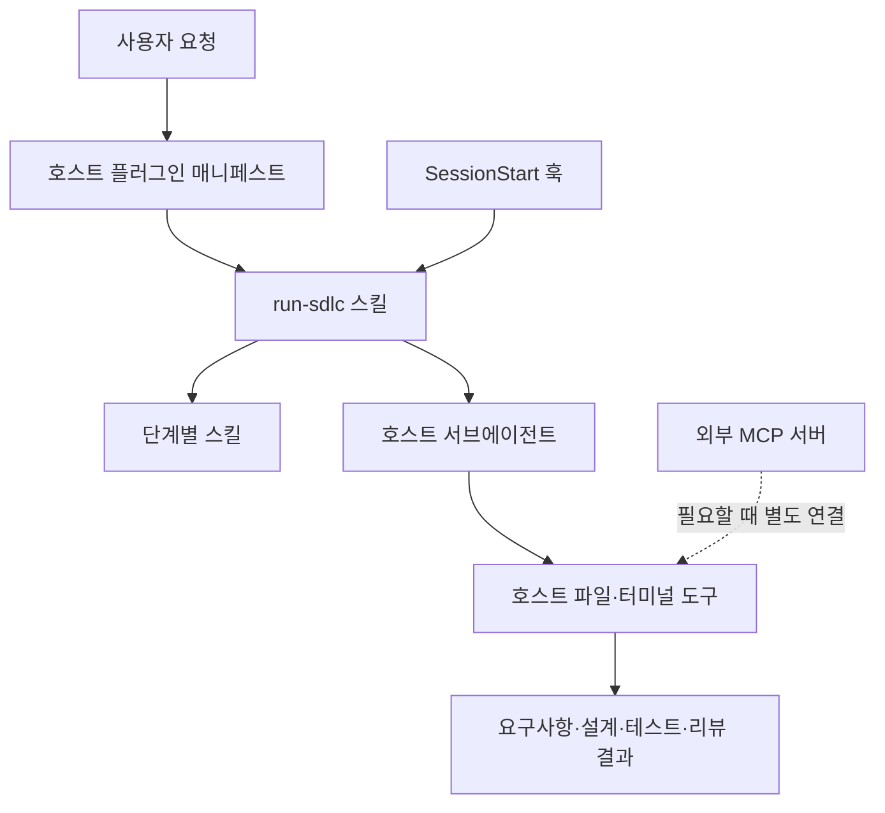

# 폴더 구성과 소스 구조 설명

이 문서는 현재 플러그인 전환 브랜치의 실제 파일을 기준으로 작성했습니다. 저장소는 별도 런타임을 실행하는 프로그램이 아니라, Codex와 Claude Code에 작업 절차와 역할을 설치하는 플러그인 소스입니다.

## 전체 실행 흐름



호스트가 모델 실행과 도구 사용, 대화 문맥, 에이전트 호출을 담당합니다. 플러그인은 호스트가 읽는 지침과 역할 파일을 제공하고, 작은 훅은 시작 이벤트에서 안내 문구만 출력합니다. MCP는 외부 시스템 연결이 필요할 때 사용자가 호스트에 별도로 연결합니다.

## 저장소 트리

```text
.agents/plugins/marketplace.json   Codex 플러그인 목록과 로컬 경로
.github/workflows/                 저장소 변경 시 플러그인 구조 검증
adapters/codex/agents/             Codex 프로젝트 전용 역할 설정(TOML)
docs/                              아키텍처·MCP·검증·소스 설명
plugins/
  codex/
    plugin.json                    Codex 호환 메타데이터
    .codex-plugin/plugin.json      Codex 패키지 매니페스트
    hooks/hooks.json               SessionStart 이벤트 연결
    hooks/session-start.sh         시작 시 짧은 진행 문서 안내 출력
    skills/                        Codex 배포용 스킬 사본
  claude/
    .claude-plugin/plugin.json     Claude Code 매니페스트
    hooks/                         Claude용 세션 시작 훅
    agents/                        Claude Code 서브에이전트 역할 6개
    skills/                        Claude 배포용 스킬 사본
scripts/sync-skills.py             공통 스킬을 호스트 패키지로 복사
skills/                            스킬의 단일 원본
 tests/test_plugin.py              배포 구조와 훅의 정적·실행 검증
```

## 핵심 폴더와 파일

| 경로 | 왜 필요한가 | 연결 관계 |
|---|---|---|
| `skills/run-sdlc/SKILL.md` | 전체 SDLC를 어떤 순서로 진행하고 재개할지 안내 | 단계별 스킬과 진행 체크포인트를 선택 |
| `skills/analyze-requirements/SKILL.md` | 요청을 확인 가능한 요구사항으로 정리 | `artifacts/requirements.md`를 결과로 삼음 |
| `skills/design-system/SKILL.md` | 구조·인터페이스·작업 의존성을 설계 | 요구사항을 구현 가능한 작업으로 분해 |
| `skills/implement-feature/SKILL.md` | 호스트 편집 도구로 실제 소스를 수정 | 설계의 범위와 담당 파일을 따름 |
| `skills/verify-change/SKILL.md` | 실제 테스트를 돌리고 증거를 남김 | `artifacts/test-report.md`에 명령과 결과를 기록 |
| `skills/review-release/SKILL.md` | 변경과 테스트 결과의 위험을 검토 | `artifacts/review.md`를 작성하거나 상위 에이전트에 전달 |
| `skills/deploy-release/SKILL.md` | 요청된 배포 절차와 헬스 확인을 안내 | 승인된 대상에 한해 실행 |
| `plugins/claude/agents/*.md` | Claude Code가 특정 역할을 별도 담당자로 호출할 수 있게 정의 | 각 에이전트가 알맞은 스킬과 도구를 사용 |
| `adapters/codex/agents/*.toml` | Codex가 인식하는 프로젝트 에이전트 설정 예시 | 프로젝트 `.codex/agents/`에 복사해 활성화 |
| `plugins/*/hooks/hooks.json` | 호스트 이벤트와 스크립트 연결을 선언 | 각 호스트의 SessionStart에서 대응 스크립트 호출 |
| `plugins/*/hooks/session-start.sh` | 재개 시 진행 문서를 확인하라는 짧은 안내 | 상태 저장이나 모델 호출 없이 텍스트 출력 |
| `.agents/plugins/marketplace.json` | Codex가 저장소 플러그인을 목록화할 위치를 가리킴 | `plugins/codex` 패키지를 등록 |
| `scripts/sync-skills.py` | 원본 스킬과 배포 사본이 달라지지 않도록 복사 | 변경 뒤 두 호스트의 `skills/`를 갱신 |
| `tests/test_plugin.py` | 매니페스트·스킬 사본·역할 설정·훅·런타임 부재 확인 | 호스트 자체의 전체 실행을 대신하지 않음 |

## 변경 시 처리 순서

1. 새 지침은 먼저 최상위 `skills/`의 원본 파일에 작성합니다.
2. `python scripts/sync-skills.py`를 실행해 Codex와 Claude 배포 사본을 갱신합니다.
3. 호스트별 역할은 각각 Claude의 Markdown agent와 Codex TOML 어댑터에서 정의합니다. 한 형식을 다른 호스트가 자동으로 읽는다고 가정하지 않습니다.
4. 훅은 꼭 필요한 이벤트에만 연결하고 스크립트 입력·출력·권한을 확인합니다.
5. 테스트로 파일 구조와 훅 실행을 확인합니다. 실제 Codex·Claude 안에서 플러그인이 활성화되는지는 각 호스트에서 별도로 확인해야 합니다.

## 무엇이 삭제되었나

이전 `sdlc_agent/` Python 패키지, CLI, 모델 프로세스 어댑터, SQLite 상태 저장소, 워크플로 엔진, 런타임용 예제와 테스트, `pyproject.toml` 패키징 설정은 제거되었습니다. 저장소의 Python 코드는 플러그인 소스 배포와 검증을 돕는 스크립트·테스트에만 남습니다. Python을 설치하지 않아도 플러그인의 주 기능을 사용하는 방향입니다.

## 지금 구조의 경계

- Claude 에이전트는 Claude Code 플러그인 내부에서 자동으로 발견되는 역할 정의입니다.
- Codex 에이전트 TOML 파일은 별도 어댑터 예시입니다. 설치 후 Codex의 프로젝트 에이전트 디렉터리에 배치해야 합니다.
- SessionStart 훅은 맥락 안내만 합니다. 테스트 통과를 기술적으로 강제하거나 작업 상태를 자동 저장하지 않습니다.
- MCP 서버는 현재 번들하지 않습니다. GitLab·DB·사내 API처럼 연결할 서비스와 접근 방식이 정해지면 호스트 설정으로 추가합니다.
- 각 호스트의 플러그인 매니페스트와 훅 규격은 독립적으로 유지해야 합니다.

[위키 검색·워크트리 스킬 안내](WIKI_WORKTREES.md) — 공통 스킬은 총 9개이며 두 호스트에 동일하게 배포됩니다.
